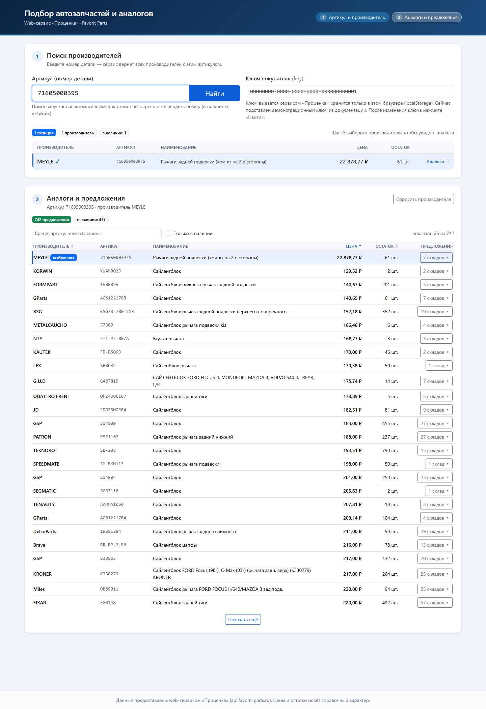

# Подбор автозапчастей и аналогов

Клиентское приложение на **React + Redux** (JavaScript, без TypeScript) для web-сервиса
«Проценка» (`api.favorit-parts.ru`). Реализует двухэтапный подбор номенклатуры:

1. **Этап 1 — поиск производителей.** Пользователь вводит артикул, приложение запрашивает сервис
   и показывает список производителей (брендов), у которых есть деталь с этим номером.
2. **Этап 2 — аналоги и предложения.** Пользователь выбирает производителя, приложение запрашивает
   аналоги для пары «номер + бренд» и показывает таблицу предложений: наименование, производитель,
   цена, остаток на складах.



## Быстрый старт

```bash
npm install
npm run dev      # http://localhost:5173/
```

Сборка и проверки:

```bash
npm run build    # production-сборка в dist/
npm test         # 28 юнит-тестов (node --test, без доп. зависимостей)
npm run preview  # локальный просмотр сборки на http://localhost:4173/
```

Требуется Node 18+ (проверено на Node 24). Ключ покупателя (`key`) подставлен демонстрационный —
тот, что указан в документации сервиса (`00000000-0000-0000-0000-000000000001`), он же работает с
реальными данными. Свой ключ вводится в поле «Ключ покупателя» и сохраняется в `localStorage`
браузера; в код ключ не зашивается.

Адрес сервиса можно переопределить переменной окружения `VITE_API_BASE` (см. `.env.example`).

Полезные ссылки-состояния (можно открывать напрямую, состояние поднимается из URL):

| Ссылка | Что показывает |
| --- | --- |
| `/?number=0189` | этап 1: четыре производителя, один без остатка |
| `/?number=7160500039S&brand=MEYLE` | этапы 1+2: 741 аналог с предложениями |
| `/?number=7260500039S` | пустой ответ: «деталь не найдена» |

## Ответы на вопросы по заданию

**Как выполняется поиск производителей (этап 1)?**
`GET /hs/hsprice/?key=…&number=…` — без `brand`. Сервис возвращает массив `goods`; каждый элемент
это товар конкретного производителя. Именно этот массив показывается на этапе 1: бренд, артикул,
наименование, цена, остаток. Запрос уходит автоматически по факту ввода (debounce 600 мс, минимум
3 символа) и по кнопке «Найти»; предыдущий незавершённый запрос отменяется через `AbortController`,
поэтому ответ старого запроса не может перезаписать новый результат.

**Как выполняется запрос аналогов (этап 2)?**
Клик по строке производителя → `GET /hs/hsprice/?key=…&number=…&brand=…&analogues=on`. Аналоги
лежат в `goods[0].analogues` — массив такой же структуры, что и `goods`. Он и есть итоговая таблица.

**Какие данные выведены по каждой позиции?**
Обязательный минимум: производитель (`brand`), наименование (`name`), цена и доступный остаток.
Дополнительно: артикул, кратность, число складов с предложениями, признак невозвратной позиции, а
по клику — раскладка по складам (склад, цена, остаток, дата/время отгрузки).

**Первая строка таблицы — сама выбранная деталь.** Сервис возвращает её склады и цены в `goods[0]`,
но в массив `analogues` она не входит: без отдельной обработки её 7 складов (у MEYLE) были бы
не видны, а в таблице остались бы только аналоги. Поэтому выбранная деталь закреплена первой
строкой с бейджем «выбранная» и не участвует в сортировке — иначе при сортировке по цене она
уезжает в середину списка.

**Откуда берётся цена?**
Не из `goods[].price` — в документации это поле помечено «НЕ ИСПОЛЬЗОВАТЬ, цена берётся из
конкретного склада». Цена = минимальная цена среди складов с положительным остатком
(`warehouses[].price`); остаток = `goods[].count` («остаток на всех складах»), с пересчётом по
складам, если сервис вернул 0. Позиции без предложений показываются как «нет в наличии / под заказ»
и всегда уходят в конец списка при сортировке по цене.

**Как обрабатываются ошибки и пустые ответы?**
Все состояния явные и различаются в интерфейсе:

| Ситуация | Что видит пользователь |
| --- | --- |
| Запрос выполняется | спиннер с подписью («Ищем производителей…» / «Загружаем аналоги для MEYLE…») |
| `goods` = одна пустая структура (деталь не найдена) | «Деталь не найдена» + подсказка проверить номер |
| `goods` пустой массив / нет `analogues` | «Аналоги не найдены», предложение выбрать другого производителя |
| `{"error": "…"}` от сервиса | текст ошибки сервиса, переведённый на человеческий язык (`Empty key!`, `Empty number goods!`, `Request quota exceeded!` и т.д.) |
| HTTP 403 + `Invalid access key` | «Неверный ключ покупателя: покупатель не найден» + «Проверьте ключ покупателя» |
| HTTP 403 + `Request quota exceeded!` | «Превышен лимит запросов по грузовому ассортименту» + совет подождать или сменить ключ |
| Нет сети / DNS / таймаут 20 с | «Не удалось связаться с сервисом…» |
| Ответ не JSON / нет поля `goods` | «Сервис вернул ответ в неизвестном формате» |

У каждой ошибки есть кнопка «Повторить», которая повторяет запрос с актуальным ключом.

**Важно про 403.** Лимит запросов сервис отдаёт тем же кодом 403, что и неверный ключ, но в теле
приходит `{"error": "Request quota exceeded!"}`. Приложение различает эти случаи по тексту ошибки:
иначе пользователю советовали бы «проверьте ключ», когда ключ верный и нужно просто подождать.
Ещё одно расхождение с документацией: документированный `Invalid key client!` на практике
приходит как `Invalid access key` — поддерживаются оба варианта.

**Как учтены особенности API?**
Экранирование спецсимволов в артикуле и бренде (`URLSearchParams`, поэтому `#`, `&`, `+`, `/` в
номерах и названиях вроде `NGK/NTK` или `J+P Group` уходят корректно); `CORS` сервис отдаёт
`Access-Control-Allow-Origin: *`, поэтому прокси не нужен; сервис работает и по HTTPS, так что
mixed content при размещении по HTTPS не возникает; параметр `info=on` не передаётся, чтобы
не усложнять ответ (признак `notRefund` при этом всё равно выводится, если сервис его вернул).

**Поиск подстрочный, а не точный.** Проверено на живом API: запрос `number=01` возвращает 21
позицию с номерами `111459423R`, `CETA009` и т.п. — совпадение по подстроке, а не по точному
номеру. Приложение не фильтрует это на своей стороне (так задумано сервисом), но именно поэтому
поиск запускается от 3 символов, а не с первого.

**Что с производительностью при 741 аналоге?**
Все данные хранятся в Redux, а фильтрация/сортировка/пагинация выполняются селектором
(`src/store/selectors.js`) и рендерятся порциями по 25 строк с кнопкой «Показать ещё». Есть
поиск по результатам (бренд/артикул/название) и переключатель «Только в наличии».

**Почему Redux, а не локальный state?**
Данные двух этапов связаны (смена артикула должна сбрасывать выбранного производителя), а
загрузка/ошибки/фильтры — это состояние, которое удобно держать в сторе. Использован Redux Toolkit
(`createSlice` + `createAsyncThunk`), без ручного написания action types и reducers.

## Структура проекта

```
src/
  App.jsx                  композиция экранов, debounce этапа 1, запуск этапа 2, синхронизация URL
  api/favoritApi.js        HTTP-клиент сервиса, разбор ошибок, нормализация ответа
  store/
    index.js               configureStore
    searchSlice.js         этап 1: артикул, ключ, goods, статус, ошибка
    offersSlice.js         этап 2: выбранный бренд, аналоги, сортировка/фильтр/лимит
    selectors.js           выборка видимых строк (фильтр + сортировка + пагинация)
  utils/format.js          цены, остатки, даты отгрузки, склонения
  utils/url.js             чтение параметров ссылки
  components/
    SearchForm.jsx         поля артикула и ключа, кнопка «Найти»
    BrandList.jsx          этап 1: список производителей
    OfferTable.jsx         этап 2: таблица аналогов, сортировка, фильтры, склады
    Loader.jsx             индикатор загрузки
    ErrorAlert.jsx         сообщение об ошибке + «Повторить»
    EmptyState.jsx         пустые состояния
  styles.css               небольшая надстройка над Bootstrap
test/                      юнит-тесты нормализации и селекторов
_docs/                     материалы проверки: выгрузка документации API, e2e-скрипты, скриншоты
```

Точка входа — `src/main.jsx` (Bootstrap CSS + `styles.css` + `Provider`).

## Проверки

- `npm test` — 39 тестов: экранирование параметров, распознавание «пустой» заглушки, расчёт цены по
  складам, разбор `goods[0].analogues` вместе с предложениями выбранной детали, фильтр/сортировка/
  пагинация селектора, закрепление выбранной строки, защита от ответов «просроченных» запросов,
  преобразование ошибок API (403 с телом, лимит запросов, `{"error": …}`, не-JSON, отсутствие ключа).
- `node _docs/e2e.mjs` — сквозной прогон в браузере через Chrome DevTools Protocol (нужен запущенный
  `npm run dev` и установленный Edge/Chrome): ввод артикула, выбор бренда, таблица, сортировка,
  «показать ещё», фильтры, раскрытие складов, повторный выбор бренда, ошибка 403, пустой ключ,
  пустой ответ, мобильная сортировка, отсутствие горизонтального скролла на 390 px, отсутствие
  ошибок и предупреждений React в консоли — 16 проверок.
- `node _docs/e2e-edge.mjs` — дополнительно: debounce (посимвольный ввод = один запрос к API),
  бренд со `/` (`NGK/NTK`), позиция без остатка, вёрстка на 768 px, состояние загрузки при
  искусственно замедленной сети — 5 проверок.
- `node _docs/e2e-ui.mjs` — правки по первому визуальному ревью: прилипающая шапка таблицы при
  прокрутке, заметность маркеров сортировки, видимый фокус при переходе с клавиатуры, табличные
  цифры в ценах, `aria-live` вне таблицы, выравнивание складов по колонкам, отсутствие «прыжка»
  страницы при загрузке, размеры тап-таргетов на 390 px — 9 проверок.
- `node _docs/e2e-visual.mjs` — правки по второму визуальному ревью и защита от регрессий:
  два шага с ровно одним активным, SVG-треугольники сортировки, отсутствие дублирующихся счётчиков,
  карточная раскладка на 768 px с одинаковыми высотами строк, склады внутри карточки, стабильная
  ширина кнопки «Найти», отсутствие горизонтального переполнения на 390 px — 18 проверок.
- `node _docs/measure.mjs` — замеры для спорных замечаний (координаты шапки и данных, ширина кнопки).
- `node _docs/e2e-base-row.mjs` — предложения выбранной детали в таблице (строка закреплена первой,
  склады раскрываются) и корректная подача ответа «Request quota exceeded!» — 5 проверок.

Скриншоты обоих прогонов складываются в `_docs/screens/`.

## Ограничения и что можно улучшить

- Ключ покупателя хранится в браузере, а запросы идут напрямую из браузера. Для публичного
  размещения правильнее держать ключ на своём бэкенде-прокси (заодно решится вопрос mixed content,
  если сайт будет открываться по HTTPS).
- Нет кэширования ответов: повторный выбор того же бренда повторяет запрос (у сервиса есть лимиты
  на грузовой ассортимент).
- Нет сохранения истории поиска и корзины/заказа — по заданию не требовалось.